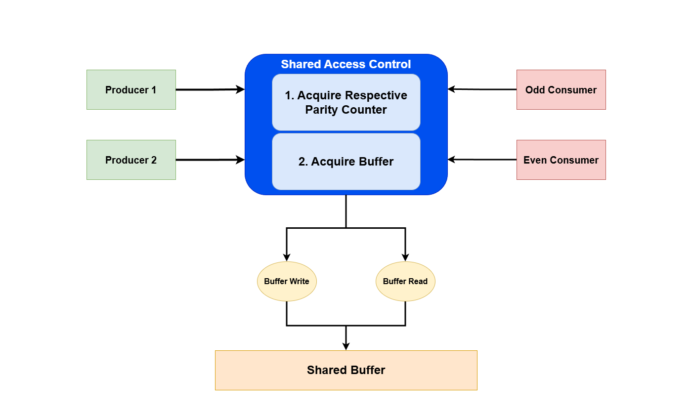

# Design Notes

## Shared Information

* `<data_structure> shared_buffer`
    * Each item contains two fields: integer in [1:100] and a bool for (odd = 1) or (even = 0)
* `int odds_in_buffer`
* `int evens_in_buffer`

*Each thread only needs to acquire its respective parity counter*

## Acqusition & Release Order

1. Acquire Parity counter (only contested by respective producer)
2. Acquire Buffer

3. Release Buffer
4. Release Parity counter

## Program Flow
### Consumers

int consumed = 0;
While (consumed < 100)
* Acquire respective parity counter
* Check if it's greater than 0
    * If not, release parity variable. GOTO end of loop
* Acquire the buffer
* Once buffer is acquired, try to acquire buffer_count
* Once acquired:
    * Take one item
    * Decrement parity counter
* Release
    * Release buffer
    * Release parity counter

### Producers

int produced = 0;
while (produced < 100)
* Acquire respective parity counter
* Acquire buffer
* Check if it has less than 50 items in it
    * If not, GOTO releases
* Write to buffer
* Increment parity counter
* Release
    * Release buffer
    * Release parity counter